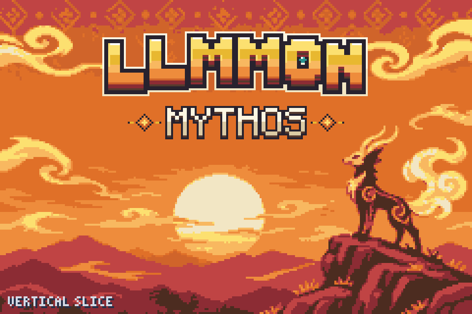
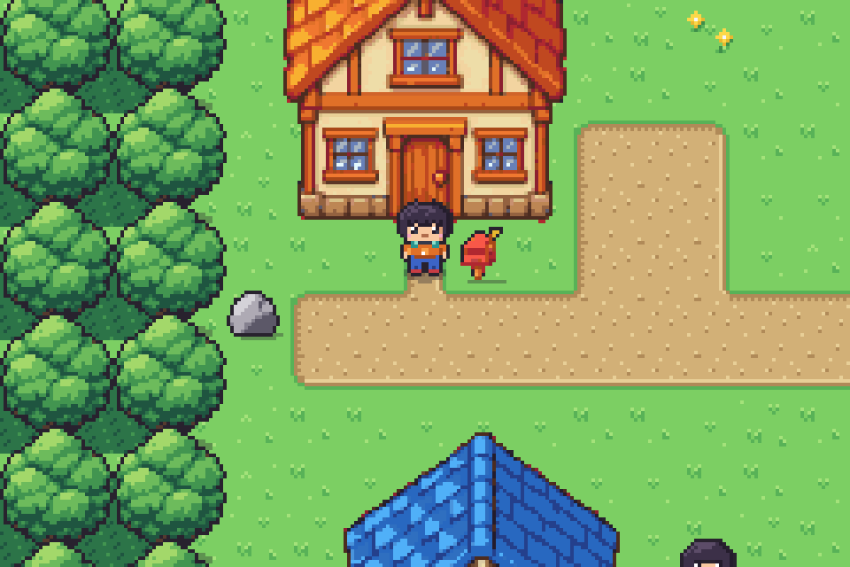
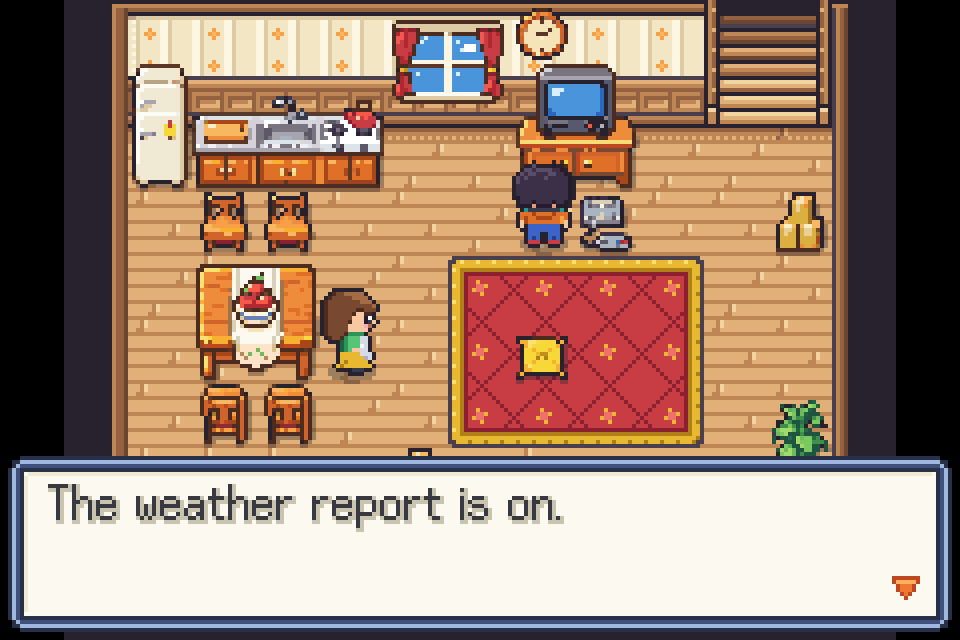
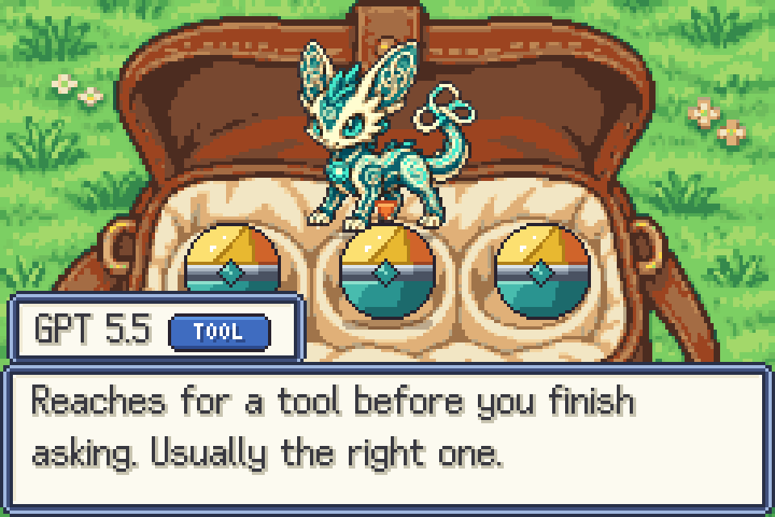
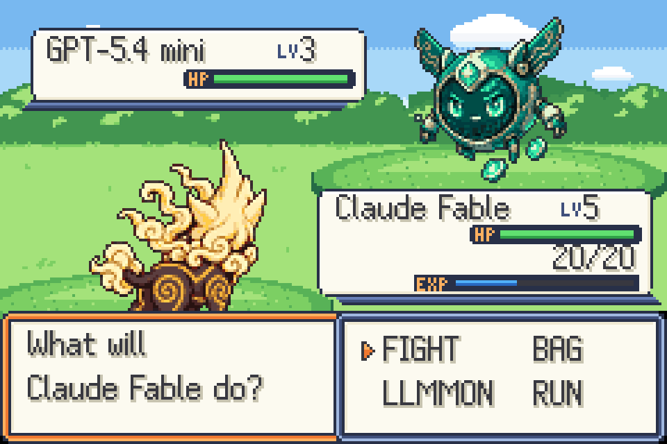
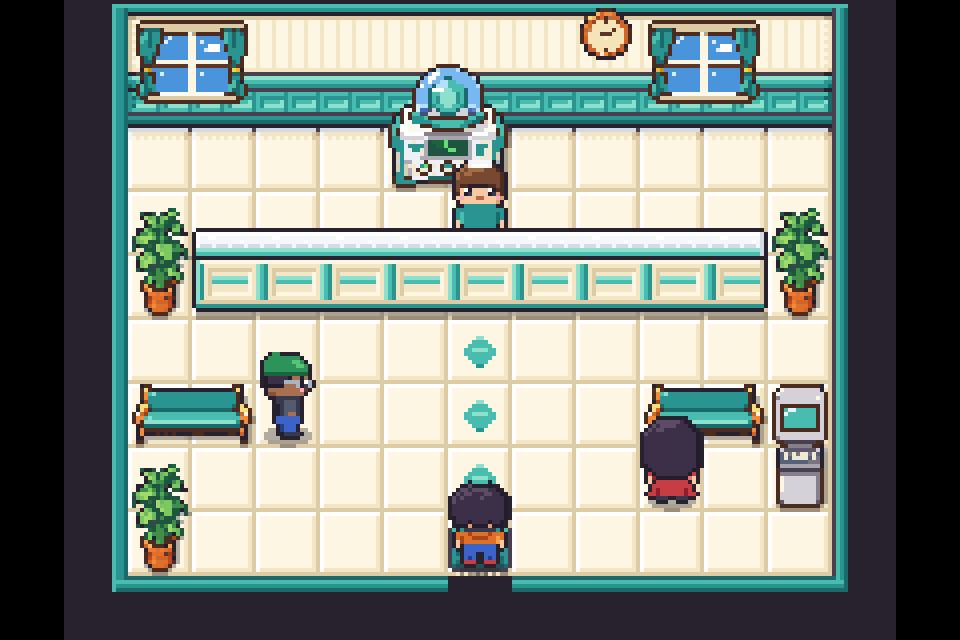

# LLMMON Mythos

[](https://github.com/arjun-krishna1/llm-mon/actions/workflows/ci-cd.yml)

A GBA-style monster-collecting RPG where the creatures are LLMs. Native
240×160, 16px grid movement, original art and chiptune audio.

| | | |
| --- | --- | --- |
|  |  |  |
|  |  |  |

## The vertical slice

Title → professor intro → move into Hayes Valley with Mom → rescue Prof.
Karpathy from a glitching HalluciHound and choose Claude Fable, GPT 5.5 or
GLM → Route 101 (wild encounters, catching, two trainers, ledges, items) →
SoMa Node (Model Center, Token Mart). About 15–25 minutes.

Controls: arrows/WASD move · Z/Space/Enter = A · X/Shift = B (hold to run) ·
Enter/Esc = menu.

## Development

```bash
npm install
```

```bash
npm run dev
```

```bash
npm run lint && npm test && npm run build
```

Useful URL flags: `?debug=1` (exposes `window.__llmmon`), `?new=1` (ignore
save), `?fast=1` (instant text/fades), `?seed=N`, `?audiotest=1`. Audition
all music and sound effects at `/src/game/audio/dev/index.html`.

## How it is built

- **Engine:** Phaser 3 + TypeScript + Vite (`src/game/`). See `docs/ENGINE_API.md`.
- **Battles:** a pure, tested battle core (`src/game/battle/core`, `docs/BATTLE_API.md`)
  rendered by `src/game/scenes/BattleScene.ts` (`docs/BATTLE_UI.md`).
- **Maps:** authored as ASCII layouts in `tools/maps/` and exported to Tiled
  JSON in `public/assets/game/maps/` (`python3 tools/maps/build.py`); the
  `.tmj` files open in the Tiled editor.
- **Art:** generated source images (cached in `tools/art/gen/raw/`) reduced to
  true low-res sprites and snapped to one master palette, plus code-drawn
  terrain, UI and characters. Rebuild with the `build.py` in each
  `tools/art/*` folder. Catalogs: `docs/ART_CATALOG_*.md`.
- **Audio:** WebAudio chiptune synth, original tracks, no audio files (`docs/AUDIO.md`).
- **Playtesting:** `node tools/playtest/run.cjs` plays the whole slice with
  real key presses; findings are in `tools/playtest/REPORT.md`.
- **Plan and contracts:** `docs/VERTICAL_SLICE_PLAN.md`.

`legacy/` holds the previous React/RPGJS prototype for reference only.

## Deployment

Pushes to `main` run lint/build in GitHub Actions and deploy to GitHub Pages.
